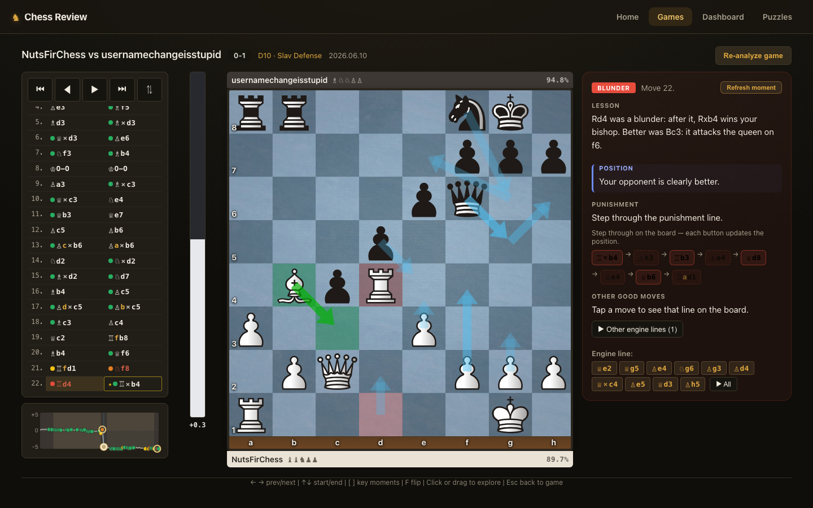
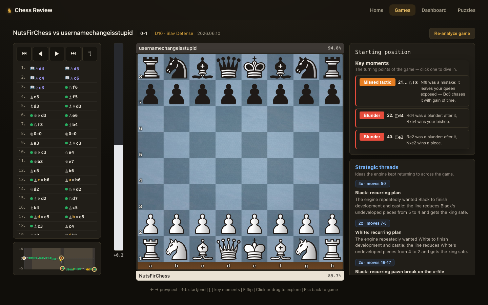
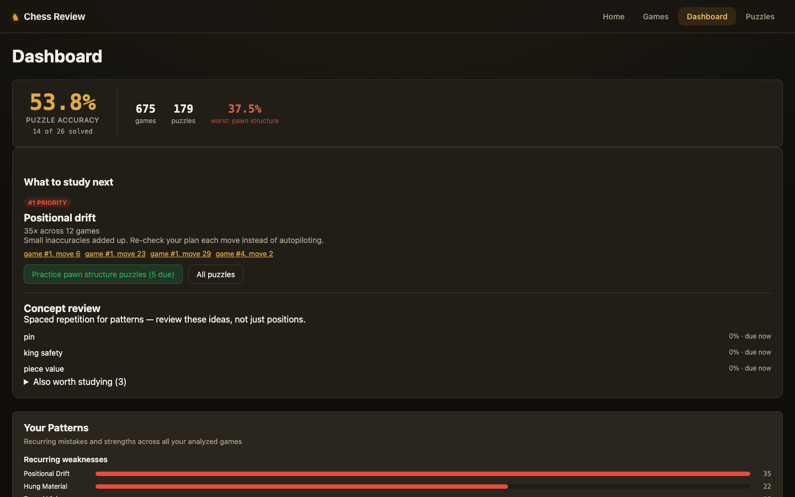

# Chess Review

A self-hosted chess analysis app that doesn't just flag a move as a mistake — it explains **why**, in plain English, the way a coach would.

Most tools paste an engine number next to your move (`-2.4`, "Blunder") and leave you to figure out the rest. Chess Review pairs a Stockfish backend with a deterministic, **LLM-free** explanation engine that turns raw engine output into sentences like *"Rd4 was a blunder: after it, Rxb4 wins your bishop. Better was Bc3 — it attacks the queen on f6."* — and a human-move model (Maia-2) that tells you whether players at your level actually find the better move.

> Built as a coaching tool for a ~1100-rated club player. The design goal: **an explanation line, read on its own, should never feel dumb or wrong.**

---

## Screenshots

**Move review with a plain-English lesson** — every flagged move gets a coach-style explanation, the refutation drawn on the board, and the engine's punishment line to step through.



| Key moments & strategic threads | Dashboard |
|---|---|
|  |  |

---

## Highlights

- **No-LLM explanation engine.** Move explanations come from a pipeline of deterministic *detectors* and *templates*, not a language model. Every claim is derived from the board and checked by an **auditor** that rejects unsupported sentences — measured at **0 false claims across 313 test positions**. Fast, free, reproducible, and unit-testable.
- **Stockfish process pool.** Analysis runs across a pool of independent Stockfish 18 (NNUE) workers at lower OS priority, so a full game analyzes in the background without freezing the UI.
- **Human-move probabilities (Maia-2).** Integrates the CSSLab Maia-2 model to answer *"would a player my rating actually have found this?"* The app runs fully without it.
- **Contrastive, multi-PV analysis** that surfaces the concrete refutation and recognizes positional/endgame themes.
- **Dashboard** of recurring weaknesses across all your games, plus a spaced-repetition queue for the underlying concepts.

## Tech stack

**Backend** — Python · FastAPI · python-chess · Stockfish 18 (NNUE) · Maia-2 (PyTorch) · SQLite
**Frontend** — React 19 · Vite · Chessground · chess.js
**Testing** — pytest (110+ tests, incl. a golden-position regression suite and a claim auditor)

~22k lines of Python plus a React SPA.

## Getting started

**Prerequisites:** Python 3.10+, Node.js 18+, and [Stockfish](https://stockfishchess.org/) (`brew install stockfish` on macOS).

```bash
# Backend
python3 -m venv venv && source venv/bin/activate
pip install -r requirements.txt

# Frontend
cd frontend && npm install && cd ..

# Config
cp .env.example .env          # edit STOCKFISH_PATH if needed
```

The Maia-2 model (~267 MB) downloads automatically on first run. Set `MAIA_ENABLED=false` in `.env` to skip it.

```bash
./start.sh          # builds the frontend, serves on http://localhost:8000
./start.sh --dev    # Vite HMR on :5173 + uvicorn on :8000
pytest              # run the test suite
```

Open the URL it prints, import a game (Chess.com username or PGN), and review.

## Project layout

```
backend/        FastAPI app, analysis pipeline, engine + Maia integration
detectors/      Deterministic board-pattern detectors
evaluators/     Positional & material concept evaluators
explanations/   Concept-specific explanation modules
frontend/       React + Vite single-page app
scripts/        Analysis tooling: auditing, golden checks, reports
tests/          pytest suite incl. golden-position regression set
```

Local databases, the Maia model weights, and build artifacts are git-ignored — they're regenerated or downloaded locally rather than committed.
